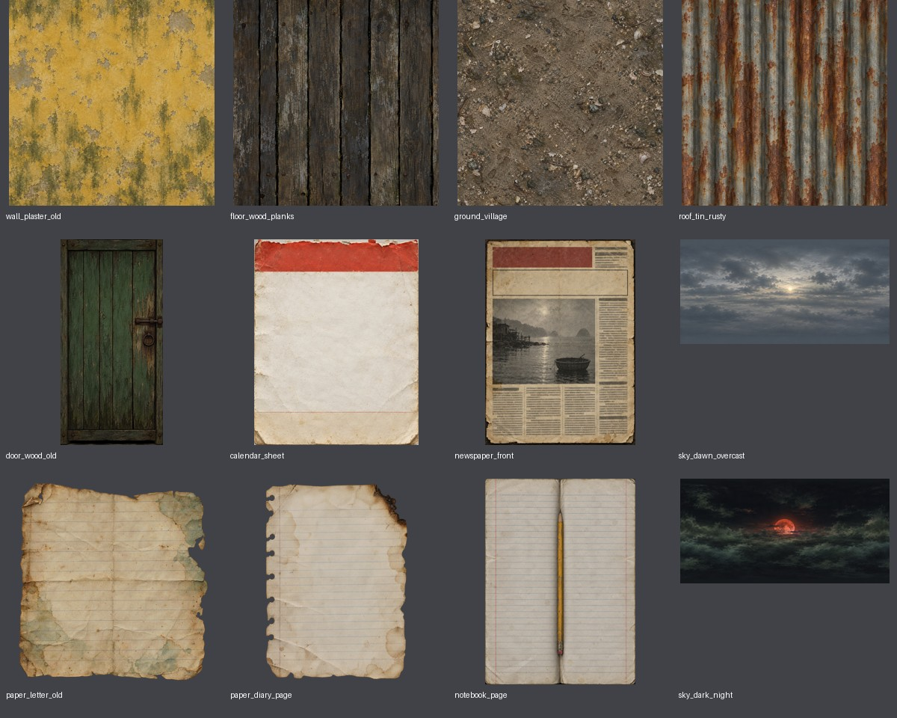
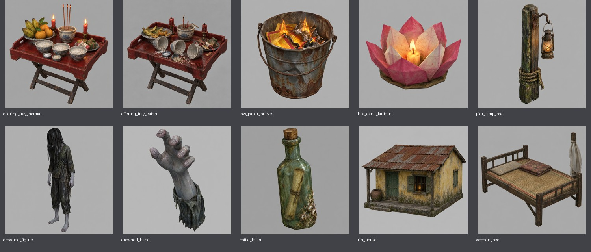

# Horror art delivery — 2026-11-02

Theo [HORROR_ART_BRIEF.md](HORROR_ART_BRIEF.md), nhánh `try-horror-1st`.

Đã tạo 22 PNG bằng built-in `image_gen`, kèm 22 file Markdown cùng tên ghi đầy đủ prompt thực tế, tool, ngày, ảnh nguồn, hậu kỳ, kích thước và SHA-256. Không sửa scene, script, material hay tích hợp runtime. Không thay bộ trời đêm/đảo dùng cho đêm yên bình.

## Ảnh review

## Danh sách bàn giao

| File | Kích thước | Định dạng |
|---|---|---|
| `assets/textures/horror/wall_plaster_old.png` | 512×512 | RGB, opaque |
| `assets/textures/horror/floor_wood_planks.png` | 512×512 | RGB, opaque |
| `assets/textures/horror/ground_village.png` | 512×512 | RGB, opaque |
| `assets/textures/horror/roof_tin_rusty.png` | 512×512 | RGB, opaque |
| `assets/textures/horror/door_wood_old.png` | 512×1024 | RGB, opaque |
| `assets/textures/horror/calendar_sheet.png` | 512×640 | RGB, opaque |
| `assets/textures/horror/newspaper_front.png` | 1024×1400 | RGB, opaque |
| `assets/textures/sea3d/sky_dawn_overcast.png` | 4096×2048 | RGB, opaque |
| `assets/concepts/horror/offering_tray_normal.png` | 1024×1024 | RGB, opaque |
| `assets/concepts/horror/offering_tray_eaten.png` | 1024×1024 | RGB, opaque |
| `assets/concepts/horror/joss_paper_bucket.png` | 1024×1024 | RGB, opaque |
| `assets/concepts/horror/hoa_dang_lantern.png` | 1024×1024 | RGB, opaque |
| `assets/concepts/horror/pier_lamp_post.png` | 1024×1024 | RGB, opaque |
| `assets/concepts/horror/drowned_figure.png` | 1024×1024 | RGB, opaque |
| `assets/concepts/horror/drowned_hand.png` | 1024×1024 | RGB, opaque |
| `assets/concepts/horror/bottle_letter.png` | 1024×1024 | RGB, opaque |
| `assets/concepts/horror/rin_house.png` | 1024×1024 | RGB, opaque |
| `assets/concepts/horror/wooden_bed.png` | 1024×1024 | RGB, opaque |
| `assets/textures/horror/paper_letter_old.png` | 1024×1024 | RGBA, transparent |
| `assets/textures/horror/paper_diary_page.png` | 1024×1400 | RGBA, transparent |
| `assets/textures/horror/notebook_page.png` | 1024×1400 | RGB, opaque |
| `assets/textures/sea3d/sky_dark_night.png` | 4096×2048 | RGB, opaque |

## Kiểm tra

- 22/22 PNG đọc được, đúng kích thước và tên file trong brief; 22/22 có provenance Markdown.
- `paper_letter_old` và `paper_diary_page` có alpha thật (0–255); các ảnh còn lại opaque.
- Đã xem bảng review và kiểm tra riêng hai trạng thái mâm cúng. Bản bị ăn được edit trực tiếp từ bản bình thường để giữ bàn gấp chữ X, khay đỏ chữ nhật và mẫu bát.
- Đã tạo lại lịch và sổ tay để bỏ cảnh nền thừa, giữ vùng chữ trống. Báo chỉ có vạch xám giả cột chữ, không có chữ đọc được.
- Kích thước đầu ra được chuẩn hóa bằng Lanczos từ ảnh nguồn; ảnh 4096×2048 là upscale, không phải native 4K. Kích thước native ghi trong từng sidecar.
- Đây là bộ ảnh chờ review, chưa có xác nhận approved. Chưa chạy Godot theo yêu cầu không tích hợp.

## Giới hạn cần review khi tích hợp

Bốn texture lặp được tạo theo prompt seamless, nhưng các mép chưa đồng nhất từng pixel. Sai khác trung bình RGB ở hai mép trái/phải và trên/dưới (thang 0–255): tường 10.83/12.31, gỗ 14.58/8.84, nền làng 17.26/18.11, tôn 11.12/11.09. Không coi đây là chứng nhận seamless; cần xem lặp ở đúng tỷ lệ material, đặc biệt đường nối ván/tôn.

Hai panorama có sai khác mép trái/phải khoảng 3.55 (bình minh), 3.44 (đêm âm). Dải 3% trên/dưới chưa được chứng nhận hoàn toàn đồng màu; cần review đường nối và cực trên sphere trước khi approved.

Nguồn gen giữ tại `/Users/nguyenthinh/.codex/generated_images/01a19b19-ca39-7e02-b125-3a24b6bac1fa/`. Các bản trước vòng sửa có backup local tại `.art_backups/horror_art_20261102/`; không có asset approved/active nào bị thay.
