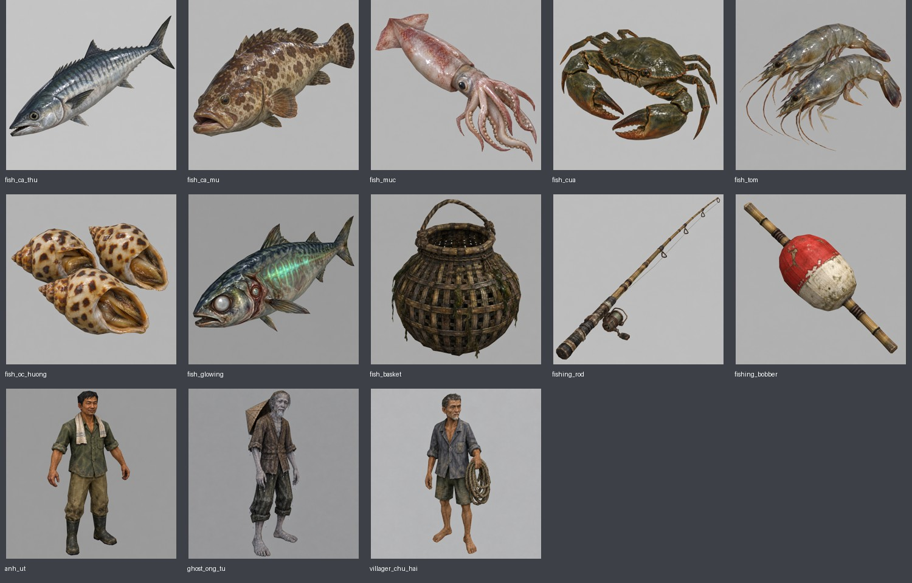
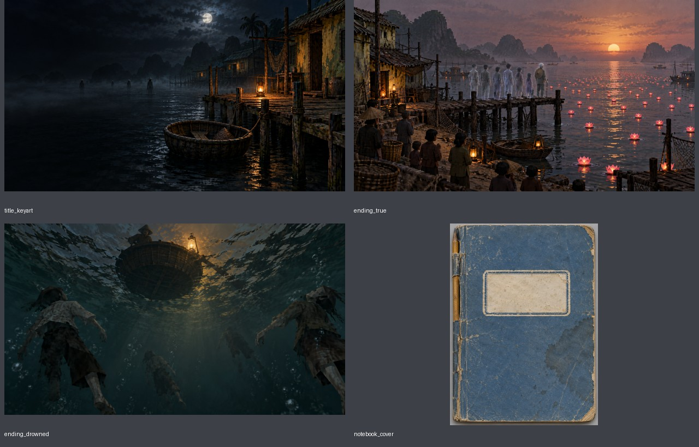

# Horror brief 2 — bàn giao art và chữ

Ngày: 2026-11-02. Nhánh `try-horror-1st`. Theo [HORROR_CODEX_BRIEF_2.md](HORROR_CODEX_BRIEF_2.md).

## Art — 17 PNG và 17 sidecar

Dùng built-in `image_gen`, mỗi item một ảnh riêng. Prompt thực tế, ảnh nguồn, tool, ngày, kích thước native, hậu kỳ và SHA-256 ghi trong `.md` cùng tên từng PNG. 13 concept có kích thước 1024×1024, nền xám nhạt opaque; 3 màn hình 1920×1080; bìa sổ 1024×1400.

| File | Kích thước |
|---|---|
| `assets/concepts/horror/fish_ca_thu.png` | 1024×1024 |
| `assets/concepts/horror/fish_ca_mu.png` | 1024×1024 |
| `assets/concepts/horror/fish_muc.png` | 1024×1024 |
| `assets/concepts/horror/fish_cua.png` | 1024×1024 |
| `assets/concepts/horror/fish_tom.png` | 1024×1024 |
| `assets/concepts/horror/fish_oc_huong.png` | 1024×1024 |
| `assets/concepts/horror/fish_glowing.png` | 1024×1024 |
| `assets/concepts/horror/fish_basket.png` | 1024×1024 |
| `assets/concepts/horror/fishing_rod.png` | 1024×1024 |
| `assets/concepts/horror/fishing_bobber.png` | 1024×1024 |
| `assets/concepts/horror/anh_ut.png` | 1024×1024 |
| `assets/concepts/horror/ghost_ong_tu.png` | 1024×1024 |
| `assets/concepts/horror/villager_chu_hai.png` | 1024×1024 |
| `assets/textures/horror/title_keyart.png` | 1920×1080 |
| `assets/textures/horror/ending_true.png` | 1920×1080 |
| `assets/textures/horror/ending_drowned.png` | 1920×1080 |
| `assets/textures/horror/notebook_cover.png` | 1024×1400 |

Đã kiểm tra ảnh đọc được, kích thước chính xác và opaque RGB. Kích thước khác native được xử lý bằng resize Lanczos giữ tỷ lệ: concept thêm lề màu nền khi cần; màn hình crop giữa khi cần. Không kéo méo hình; kích thước nguồn và cách xử lý ghi riêng trong sidecar.

Đã xem từng nhóm qua bảng review: hai con tôm, ba ốc hương; cá dị biến có ánh xanh dọc sống và mắt phụ; nền menu chừa phần tối bên trái; kết thật có bảy hồn ở cầu tàu, ông Tư cuối hàng với nón sau lưng; bìa sổ có nhãn trắng không chữ. `ending_drowned` dùng góc nhìn hồn Rin dưới nước nhìn lên thúng theo prompt của brief, không thêm hình Rin nhìn từ ngoài.

Ông Tư được chỉnh bỏ giỏ/lưới phát sinh; Chú Hai được chỉnh bỏ nón phát sinh để giữ phụ kiện đúng brief. Ảnh trước chỉnh và provenance được giữ trong backup local `.art_backups/horror_art_2_20261102/`.

## Chữ — bản nháp chờ duyệt

[HORROR_TEXTS_DRAFT.md](HORROR_TEXTS_DRAFT.md) là file duy nhất chứa nội dung chữ đề xuất, đủ:

- 21 trang Bản tin Ngủ Quên: 7 ngày × 3 biến thể, mỗi trang một câu tít và một câu tin.
- 12 manh mối có ngày mở sớm nhất và loại `letter` / `diary` / `object`.
- 40 lời đồn: 20 Cô Năm, 10 Bảo, 10 Chú Hai; có ngày, trạng thái và điều kiện phụ khi cần.
- 18 câu bổ sung cho đúng 9 ID điềm đang có trong `data/omens/`.
- 6 câu hoa đăng và 4 câu anh Út đêm rằm.

Đã kiểm số lượng và ID, kiểm báo D1–D5 không nhắc anh Út. Thư ông Tư thuộc hai năm trước; nhật ký thuộc năm ngoái. Không có lời tự giải thích của Rin. Những dòng biết đã tìm được bảy nạn nhân chỉ dành cho kết thật; các lời trước đêm rằm không nói như thể sự việc đã giải quyết.

Ngày sớm nhất và điều kiện là metadata biên tập, chưa thêm trường hay logic vào game. `after_wrong` dùng ngày lịch sau reset và cờ nhánh riêng để lời về vệt chân chỉ hiện sau `last_calm_miss`.

## Trạng thái

Toàn bộ là bản chờ duyệt. Không sửa scene, script, `.tres`, không tạo model Hunyuan, không tích hợp runtime. Không thay asset approved/active. `ASSETS.md` chỉ bổ sung catalog bàn giao. Không chạy Godot vì đợt này chỉ giao ảnh và chữ; kiểm tra file PNG, sidecar, nội dung bảng và `git diff --check`.
