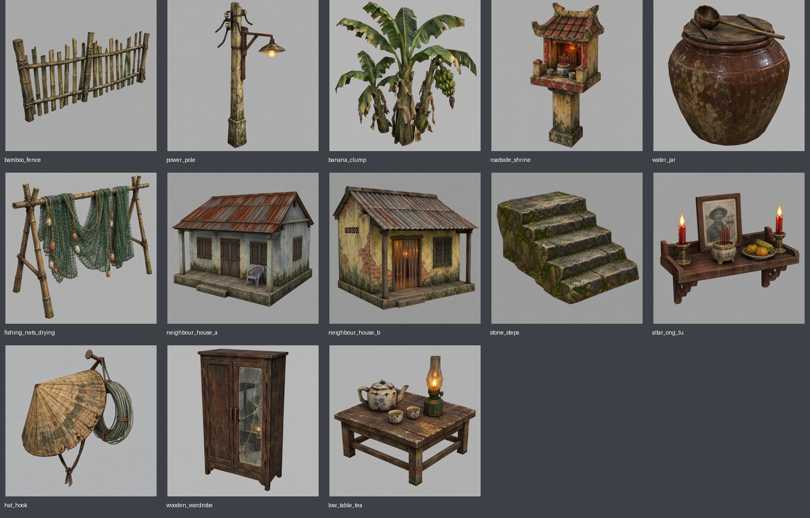
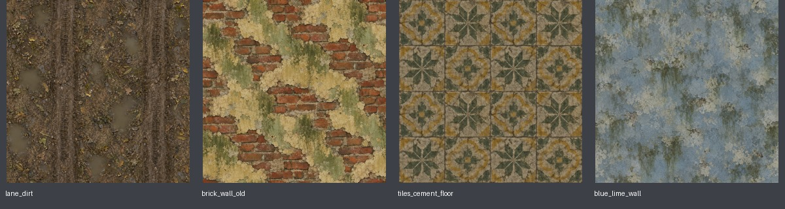
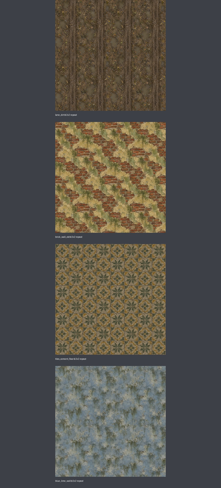

# Horror brief 3 — concept làng liền mạch

Ngày: 2026-11-02. Nhánh `try-horror-1st`. Theo [HORROR_CODEX_BRIEF_3.md](HORROR_CODEX_BRIEF_3.md).

Đã tạo 17 PNG bằng built-in `image_gen`, từng item một ảnh, kèm 17 sidecar Markdown cùng tên ghi prompt thực tế, tool, ngày, ảnh nguồn, kích thước native, hậu kỳ và SHA-256. Đầu ra gồm 13 concept 1024×1024 và 4 texture 512×512, đều opaque RGB.

## 13 concept cho image-to-3D

Đã xem toàn bộ bảng review: vật thể trọn khung trên nền xám nhạt, góc ba phần tư; cụm chuối có ba cây và buồng xanh; bậc đá có năm bậc; nhà A có ghế nhựa và cửa chớp đóng; nhà B có mái tấm lượn sóng và rèm nhựa. Bàn thờ có ảnh hư cấu bạc màu, bát nhang, trái cây và hai nến đỏ. Bàn trà có ấm, hai chén và đèn dầu. Không có chữ đọc được.

Bàn thờ và nón treo được tách thành asset rời, không thêm cả bức tường/phòng làm nền. `hat_hook` được chỉnh bỏ phao/chì phát sinh, giữ nón và cuộn dây câu đúng brief; bản trước chỉnh được lưu local tại `.art_backups/horror_art_3_20261102/`.

## 4 texture và kiểm tra lặp

Đã xem lặp 2×2: vệt bánh xe theo chiều dọc, tường gạch/vôi và gạch bông tiếp tục qua mép mà không xuất hiện đường nối lớn nổi bật ở kích thước review. Họa tiết có thể lộ sự lặp khi phủ diện tích lớn. Các mép gần khớp, chưa đồng nhất từng pixel; không coi số đo dưới đây là chứng nhận seamless tuyệt đối.

| Texture | Sai khác RGB trung bình trái/phải | Trên/dưới |
|---|---:|---:|
| lane_dirt | 16.53 | 17.30 |
| brick_wall_old | 16.26 | 15.90 |
| tiles_cement_floor | 12.17 | 20.01 |
| blue_lime_wall | 12.88 | 12.51 |

Thang đo 0–255, tính trên PNG cuối 512×512. Chưa kiểm tại tỷ lệ vật liệu trong Godot.

## Danh sách bàn giao

| File | Kích thước |
|---|---|
| `assets/concepts/horror/bamboo_fence.png` | 1024×1024 |
| `assets/concepts/horror/power_pole.png` | 1024×1024 |
| `assets/concepts/horror/banana_clump.png` | 1024×1024 |
| `assets/concepts/horror/roadside_shrine.png` | 1024×1024 |
| `assets/concepts/horror/water_jar.png` | 1024×1024 |
| `assets/concepts/horror/fishing_nets_drying.png` | 1024×1024 |
| `assets/concepts/horror/neighbour_house_a.png` | 1024×1024 |
| `assets/concepts/horror/neighbour_house_b.png` | 1024×1024 |
| `assets/concepts/horror/stone_steps.png` | 1024×1024 |
| `assets/concepts/horror/altar_ong_tu.png` | 1024×1024 |
| `assets/concepts/horror/hat_hook.png` | 1024×1024 |
| `assets/concepts/horror/wooden_wardrobe.png` | 1024×1024 |
| `assets/concepts/horror/low_table_tea.png` | 1024×1024 |
| `assets/textures/horror/lane_dirt.png` | 512×512 |
| `assets/textures/horror/brick_wall_old.png` | 512×512 |
| `assets/textures/horror/tiles_cement_floor.png` | 512×512 |
| `assets/textures/horror/blue_lime_wall.png` | 512×512 |

## Hậu kỳ, kiểm tra và trạng thái

Ảnh nguồn gen được giữ nguyên ở đường dẫn ghi trong từng sidecar. Chuẩn hóa kích thước bằng Lanczos; concept giữ tỷ lệ, thêm lề màu nền nếu cần. Không vẽ lại bằng code hay ép bảng màu sprite. Prompt luôn mở đầu bằng shared style của brief gốc.

Kiểm tra: 17 PNG đọc được, đúng kích thước, opaque RGB; 17 sidecar có đủ provenance và checksum khớp; đã xem concept và bản lặp texture. `git diff --check` không báo lỗi.

Đây là bộ ảnh chờ duyệt cho bước Hunyuan. Không dựng bản đồ hoặc model 3D, không sửa scene, script, material, `.tres` hay tích hợp runtime; không thay tài sản approved/active. `ASSETS.md` chỉ bổ sung catalog. Không chạy Godot cho đợt bàn giao ảnh này.
