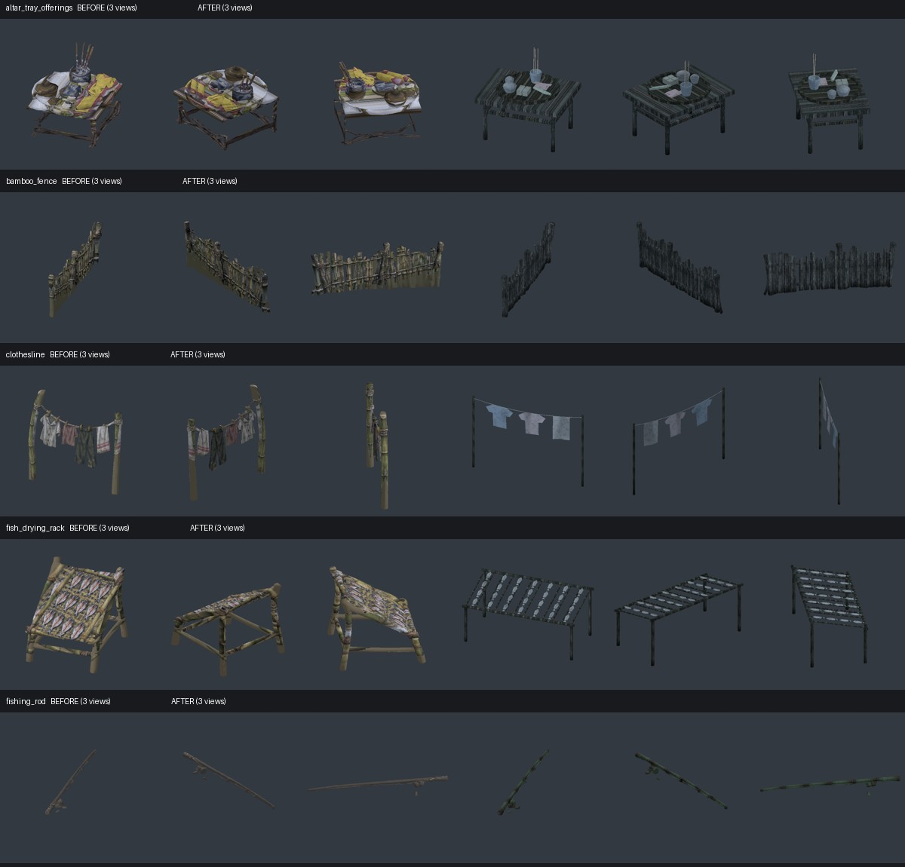
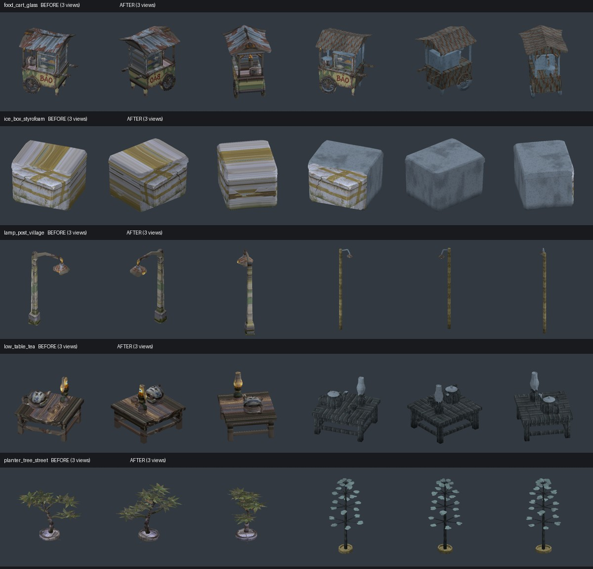
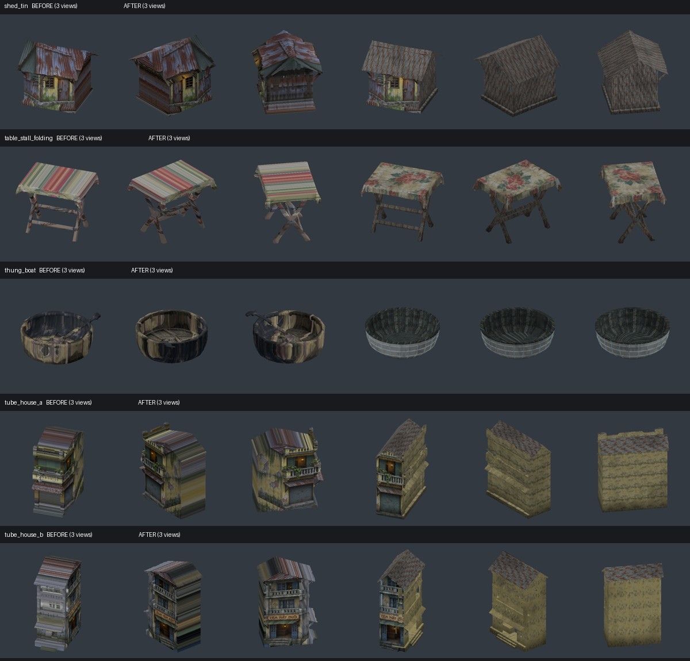
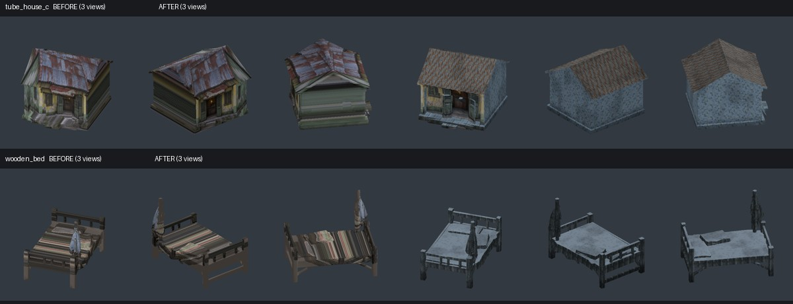

# Horror brief 6 — bàn giao 05/11/2026

Hoàn thành mục 1–7 trên 17 model. Raw Hunyuan/concept PNG giữ nguyên. Backup 46 file trước sửa: `.art_backups/brief6_20261104/manifest.json`, đã kiểm SHA.

## Thay đổi

1. Nhà A/B/C: UV tường cũ tile ở hông/sau, tôn gỉ ở mái; mặt tiền dùng concept với UV riêng. A/B hướng +Z theo builder, giữ footprint/chiều cao. Kiểm tra ba góc và ảnh đêm ngoài đường, camera 1,6 m, 1280×720.
2. Xe Bảo: mặt chữ chỉ hiện hướng ra ngoài, mặt sau không còn chữ ngược; hông/sau/mái dùng UV riêng.
3. Cây bàng: giữ bồn, thân thẳng, bốn tầng cành ngang và lá tròn. Slot ngoài đường cao 4,2 m; các slot chậu nhỏ vẫn theo placement hiện có.
4. Dựng lại mâm cúng (khay, gạo/muối, bánh, giấy áo, bình, nhang), dây phơi/quần áo, nan giàn cá, tay đèn nối liên tục.
5. Cần câu/giường/bàn trà/hàng rào: UV gỗ/vải/gốm dịu thay vùng trắng do projection. Giữ shader uốn cần câu.
6. Nhà tôn/thùng xốp: giữ chi tiết trước, sửa hông/sau/mái với UV riêng.
7. Bàn xếp hiện khăn hoa ở mặt/viền và chân X gỉ. Thúng có vành/lòng đan tre, vỏ chai sẫm; bỏ mái chèo baked, scene còn một mái chèo game. Giữ sàn ở tỷ lệ 0,16 để khớp logic đứng. Hông xe xử lý cùng mục 2.

Material native đi qua StylePass, không đổi StyleGuide. Không chỉnh placement quán, sea/fishing.

## Ảnh trước/sau

Mỗi hàng: trước sửa ba góc trái; sau sửa ba góc phải.

Ảnh gameplay sau sửa 1280×720:

- [tube_house_a](art_reviews/brief6_game_tube_house_a.png)
- [tube_house_b](art_reviews/brief6_game_tube_house_b.png)
- [tube_house_c](art_reviews/brief6_game_tube_house_c.png)
- [table_stall_folding](art_reviews/brief6_game_table_stall_folding.png)
- [food_cart_glass](art_reviews/brief6_game_food_cart_glass.png)
- [planter_tree_street](art_reviews/brief6_game_planter_tree_street.png)
- [thung_boat](art_reviews/brief6_game_thung_boat.png)

Ảnh giữ hiệu ứng sương/biển hiệu của world hiện hành. Cây ở rìa làng có màn sương sáng sẵn. Vật liệu/hình học vẫn đơn giản theo phong cách low-poly.

## Budget và nguồn

| Model | Tam giác |
|---|---:|
| altar_tray_offerings | 1,164 |
| bamboo_fence | 3,000 |
| clothesline | 308 |
| fish_drying_rack | 1,236 |
| fishing_rod | 3,000 |
| food_cart_glass | 3,000 |
| ice_box_styrofoam | 3,000 |
| lamp_post_village | 200 |
| low_table_tea | 2,000 |
| planter_tree_street | 2,635 |
| shed_tin | 3,000 |
| table_stall_folding | 3,000 |
| thung_boat | 2,592 |
| tube_house_a | 5,000 |
| tube_house_b | 5,000 |
| tube_house_c | 5,000 |
| wooden_bed | 3,000 |

Catalog đủ 50 ID, tổng **135.131 tam giác**; các model sửa trong budget cũ. UV/normals hữu hạn, normals chuẩn hóa, SHA reduced khớp provenance và raw SHA không đổi. [Validation](art_reviews/brief6_validation_20261105.json).

Nguồn: 17 file `art_source/horror/brief6/<id>.blend`, texture packed; [recipe](../tools/art/finish_horror_brief6.py). Thư mục source có `.gdignore` ở cấp cha. Renderer `concept_model_3d.gd` giữ native UV; shader projection hỗ trợ UV cần câu và mặt chữ hướng ra ngoài.

## Kiểm thử

- `tools/run_tests.sh`: **ALL OK** (`build/brief6/tests_final.log`).
- `tools/run_bot.sh`: **BOT OK**, hết ngày 7/ending (`build/brief6/bot_final.log`).
- Test mới `horror_finish_test`: UV/vật liệu nhà, mặt chữ, chiều cao cây, sàn/mái chèo thúng, shader cần câu.
- Review 50 model × 3 góc; capture chạy `-- --no-autosave`.
- Không push.
