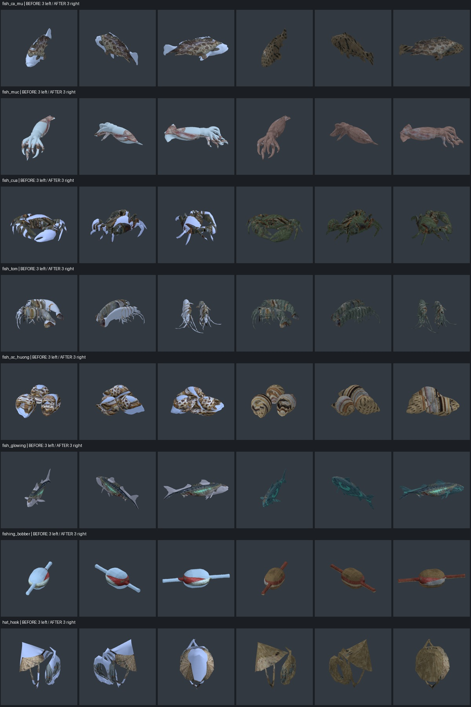
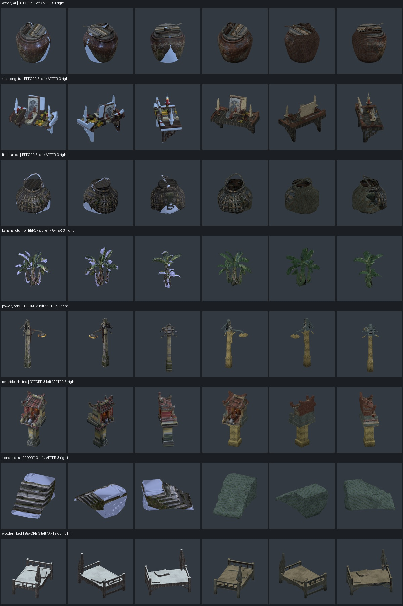
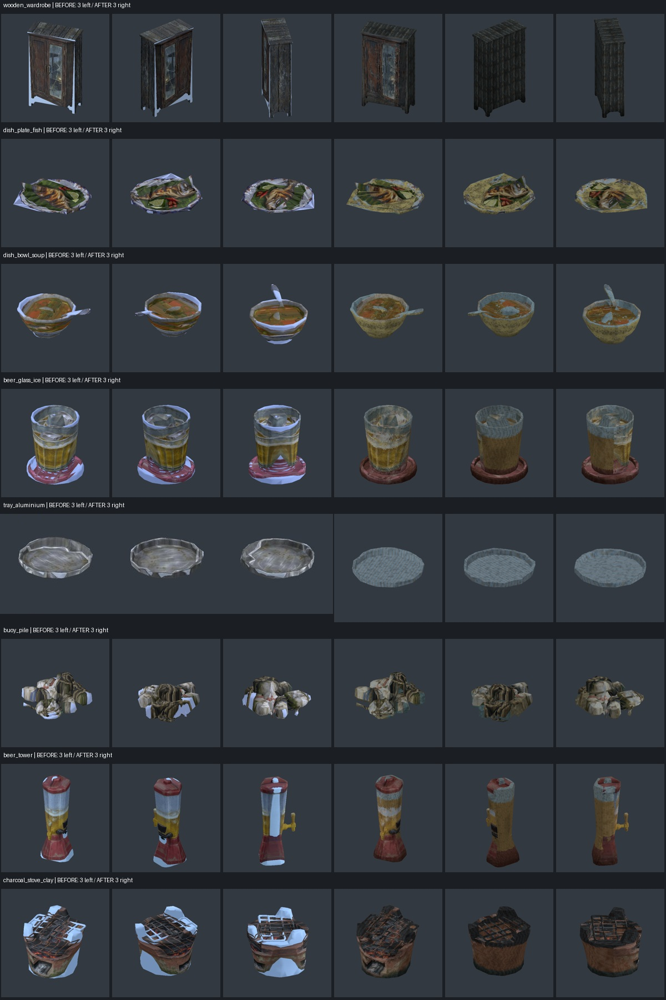
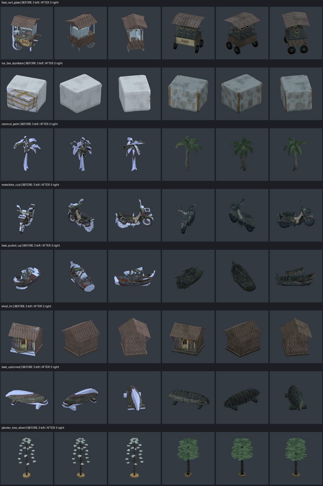

# Horror brief 7 — bàn giao 05/11/2026

Đã làm theo bản cập nhật có **mục 2b — picture-in-picture**. Catalog vẫn đủ 50 ID; sửa material/UV của **32 model**, dựng lại cây bàng và xe Bảo. Tổng hiện tại **133.808 tam giác**, trong budget cũ. Giữ nguyên raw Hunyuan, concept gốc và StyleGuide.

## 1. Mảng trắng/tím và vật liệu

Nguồn lỗi chung là phép chiếu lấy nền xám hoặc sai phần concept trên mặt khuất. Ngưỡng màu trên GPU còn chịu chuyển đổi sRGB/linear. Pass này phân loại nền trong ảnh sRGB khi bake, tạo atlas UV có padding và phủ vật liệu có vân ở vùng thiếu; không đổi shader chung để tránh ảnh hưởng các model đã sạch.

- Lò đất: thân đất nung, bồ hóng và vỉ tối, hết nền nhạt ở vành/thân.
- Hai thuyền: giữ phần sơn/mắt ở mặt bên thích hợp; sống, boong, lòng và đáy dùng UV gỗ riêng. Cây dừa/chuối có màu thân, đốt và lá đầy đủ.
- Sáu hải sản: vỏ/vảy/da, càng, râu, đầu, đuôi và vây có màu phủ kín. Cá phát sáng vẫn nhận `glow` khi cầm trên tay; shader uốn cần câu giữ nguyên.
- Phao, nón/móc, bậc đá, xe Cub, chum, giỏ, tủ, nhà tôn, phao cuộn, bàn thờ, đồ ăn/bia: xử lý mặt khuất, đáy và chi tiết nhỏ. Chân cột điện/miếu dùng UV tile, hết sọc chiếu đứng.
- Giường có chiếu sợi vàng nâu và đường viền; thùng xốp có vết bẩn/băng keo trên nắp, mặt sau và hai hông.
- Gốm mặt ngoài/đáy tô và đĩa dùng vật liệu riêng; artwork thức ăn chỉ ở phía trên. Không còn ảnh món ăn dán dưới đĩa hoặc ngoài tô.

## 2. Cây, xe và biển hiệu

**Bàng:** giữ bồn, thân dày hơn, ba tầng tán ngang với 252 lá bản rộng chồng lên nhau. Tán rộng hơn chiều sâu theo phương đứng của phần tán; slot ngoài đường vẫn cao khoảng 4,2 m và nằm trong footprint hiện có. [Ảnh cùng Rin](art_reviews/brief7_game_planter_tree_street.jpg).

**Xe Bảo:** dựng lại thân/vành bánh, mái tôn, khung tủ và hai kệ. Ba tấm kính tối có alpha khoảng 0,14, bên trong là sáu tô/thức ăn bằng mesh. Biển BẢO là mặt riêng, một chiều; sau xe không có chữ ngược. Giữ kích thước ngoài và đường dẫn GLB để placement nhận ngay. [Ảnh trong quán](art_reviews/brief7_game_food_cart_glass.jpg).

**Biển hiệu:** nhà B có `tap_hoa` (TẠP HOÁ CÔ SEN), `sua_xe` (SỬA XE CHÚ TƯ), `thuoc_bac` (THUỐC BẮC AN HOÀ), `plain` (không chữ). Nhà A/C vốn không có bảng chữ cùng kiểu nên giữ nguyên. Mỗi instance B mặc định chọn ổn định theo vị trí; placement có thể chọn rõ bằng hook:

```gdscript
var house := ConceptModel3D.fit(parent, "tube_house_b", at, size, yaw)
ConceptModel3D.set_sign_variant(house, "sua_xe")
```

Hook dùng material riêng theo instance, không sửa mesh/texture dùng chung; trả `false` nếu ID/key không hợp lệ. Kiểm tra key đang dùng bằng `house.get_meta("sign_variant")`. Không chỉnh file placement quán/sea/fishing.

Ảnh các lựa chọn: [tạp hoá](art_reviews/brief7_game_sign_tap_hoa.jpg), [sửa xe](art_reviews/brief7_game_sign_sua_xe.jpg), [thuốc bắc](art_reviews/brief7_game_sign_thuoc_bac.jpg), [không chữ](art_reviews/brief7_game_sign_plain.jpg).

## 2b. Kiểm tra ảnh trong ảnh

Đã xem đủ **50 × 6 hướng**: trước, sau, trái, phải, trên, dưới; thêm bộ ba góc cũ. [Danh sách audit từng ID](art_reviews/brief7_six_side_audit.json).

Các trường hợp ảnh/khung concept lặp rõ cần xử lý: **`dish_plate_fish`** (cả hình đĩa/món ở đáy), **`hat_hook`** (hình nón lặp trong lòng), **`stone_steps`** (hình bậc lặp ở mặt phẳng/đáy), **`tray_aluminium`** (ảnh khay/vành lặp ở đáy). Khay được thêm vào phạm vi sửa theo mục 2b, dù danh sách ban đầu ghi sạch.

Các mặt còn lấy sai mảnh concept/chất liệu: `water_jar`, `fish_basket`, `dish_bowl_soup`, `beer_glass_ice`, `charcoal_stove_clay`, `boat_pulled_up`, `boat_upturned`, `wooden_wardrobe`, `shed_tin`, `altar_ong_tu`, `roadside_shrine`, `power_pole`. Đã thay các đáy/nắp/lưng và mặt kết cấu liên quan bằng vật liệu riêng. Không thấy ảnh toàn model, khung concept hay nền nhạt còn lộ trong ảnh audit cuối.

[So sánh mặt khuất trước/sau](art_reviews/brief7_projection_spill.jpg). Baseline sáu hướng được dựng từ GLB đã commit ở `7b9d0f6` qua GLTFDocument; dùng để so vị trí chi tiết chiếu. Màu trắng/tím trước sửa xem bộ ba góc gốc và năm sheet tham chiếu trong brief.

Bộ đầy đủ sáu hướng: [1](art_reviews/brief7_all_sides_1.jpg), [2](art_reviews/brief7_all_sides_2.jpg), [3](art_reviews/brief7_all_sides_3.jpg), [4](art_reviews/brief7_all_sides_4.jpg), [5](art_reviews/brief7_all_sides_5.jpg).

## 3. Ảnh trước/sau và gameplay

Mỗi hàng: ba góc trước bên trái, ba góc sau bên phải.









Ảnh trong game, 1280×720, vật thể ở placement hiện hành:

- [Lò](art_reviews/brief7_game_charcoal_stove_clay.jpg), [thuyền úp](art_reviews/brief7_game_boat_upturned.jpg), [thuyền kéo bờ](art_reviews/brief7_game_boat_pulled_up.jpg), [dừa](art_reviews/brief7_game_coconut_palm.jpg).
- Hải sản trên tay: [cá mú](art_reviews/brief7_game_hand_ca_mu.jpg), [cua](art_reviews/brief7_game_hand_cua.jpg), [tôm](art_reviews/brief7_game_hand_tom.jpg), [mực](art_reviews/brief7_game_hand_muc.jpg), [ốc hương](art_reviews/brief7_game_hand_oc_huong.jpg), [cá phát sáng](art_reviews/brief7_game_hand_ca_thu_phat_sang.jpg).

Ảnh giữ ánh sáng/sương hiện hành của world; ở rìa làng vẫn có dải sương sáng. Hình học Hunyuan ở các model không dựng lại còn thô, vật liệu chủ ý đơn giản theo low-poly; không phải pass làm lại topology toàn bộ 50 model.

## 4. Budget, nguồn và kiểm thử

| ID sửa | Tam giác / budget |
|---|---:|
| fish_ca_mu | 2,000 / 2,000 |
| fish_muc | 2,000 / 2,000 |
| fish_cua | 2,000 / 2,000 |
| fish_tom | 2,000 / 2,000 |
| fish_oc_huong | 2,000 / 2,000 |
| fish_glowing | 2,000 / 2,000 |
| fishing_bobber | 2,000 / 2,000 |
| hat_hook | 2,000 / 2,000 |
| water_jar | 2,000 / 2,000 |
| altar_ong_tu | 2,000 / 2,000 |
| fish_basket | 3,000 / 3,000 |
| banana_clump | 3,000 / 3,000 |
| power_pole | 3,000 / 3,000 |
| roadside_shrine | 3,000 / 3,000 |
| stone_steps | 2,998 / 3,000 |
| wooden_bed | 3,000 / 3,000 |
| wooden_wardrobe | 3,000 / 3,000 |
| dish_plate_fish | 2,000 / 2,000 |
| dish_bowl_soup | 2,000 / 2,000 |
| beer_glass_ice | 2,000 / 2,000 |
| tray_aluminium | 2,000 / 2,000 |
| buoy_pile | 2,000 / 2,000 |
| beer_tower | 3,000 / 3,000 |
| charcoal_stove_clay | 3,000 / 3,000 |
| food_cart_glass | 1,876 / 3,000 |
| ice_box_styrofoam | 3,000 / 3,000 |
| coconut_palm | 2,998 / 3,000 |
| motorbike_cub | 3,000 / 3,000 |
| boat_pulled_up | 3,000 / 3,000 |
| shed_tin | 3,000 / 3,000 |
| boat_upturned | 3,000 / 3,000 |
| planter_tree_street | 2,436 / 3,000 |

18 GLB còn lại giữ nguyên. Nhà B chỉ có texture biển hiệu bổ sung, GLB không đổi. Mọi raw SHA giữ nguyên, reduced SHA khớp provenance; UV/normals hữu hạn và normals chuẩn hóa. [Validation](art_reviews/brief7_validation_20261105.json).

Nguồn Blender: `art_source/horror/brief7/<id>.blend` (32 file, texture packed). Backup trước sửa và manifest SHA ở `.art_backups/brief7_20261105/`; bản nguồn trung gian cũng được giữ để phục hồi. Recipe: [finish_horror_brief7.py](../tools/art/finish_horror_brief7.py), [export source](../tools/art/save_horror_brief7_sources.py), [validate](../tools/art/validate_horror_brief7.py), [ghép ảnh](../tools/art/package_horror_brief7_review.py).

Review: `review_horror_models.gd -- --no-autosave` cho ba góc; thêm `--all-sides` cho sáu hướng. Để tái dựng baseline: chạy `python3 tools/art/stage_horror_brief7_baseline.py`, rồi thêm `--all-sides --baseline`. Capture gameplay: `tools/art/capture_brief7.tscn -- --no-autosave`.

- `tools/run_tests.sh`: **ALL OK** — [log](art_reviews/brief7_tests.txt).
- `tools/run_bot.sh`: **BOT OK**, hết ngày 7 và ending — [log](art_reviews/brief7_bot.txt).
- `horror_coverage_test`: **38 PASS** (UV/vật liệu, kính/thức ăn, cá phát sáng, biển hiệu tách theo instance); `horror_finish_test`: **8 PASS**; `style_test`: **19 PASS**. Sau điều chỉnh cuối mặt bàn thờ, coverage/style được chạy lại và đều qua.
- `git diff --check` sạch; không push.

Nguồn Blender còn có `sources.json` đối chiếu SHA của cả GLB và file nguồn, tránh bàn giao nhầm phiên bản.
