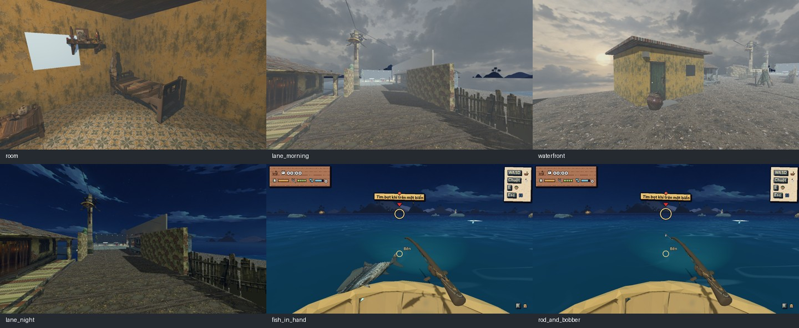
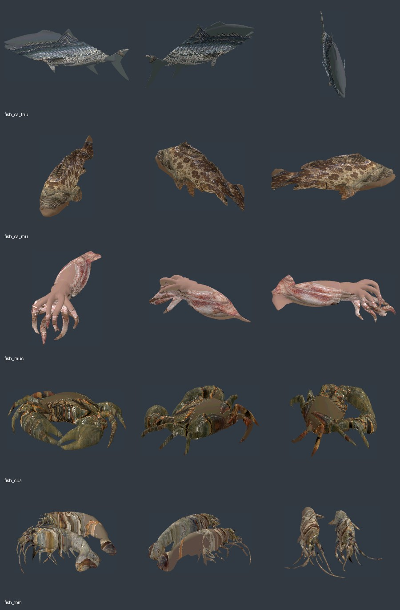
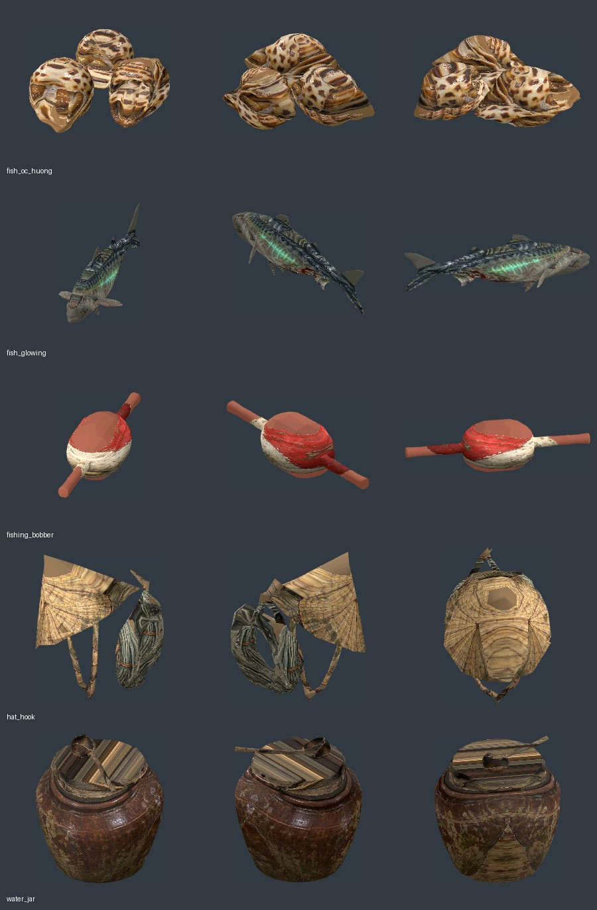
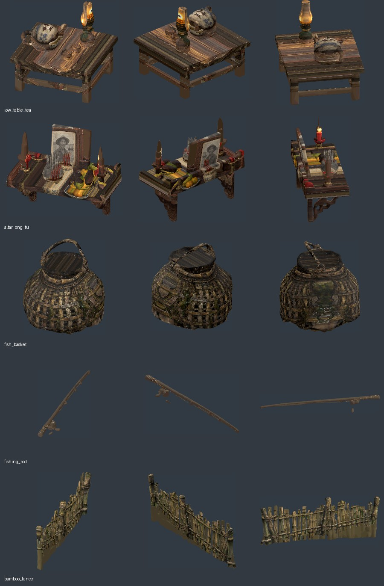
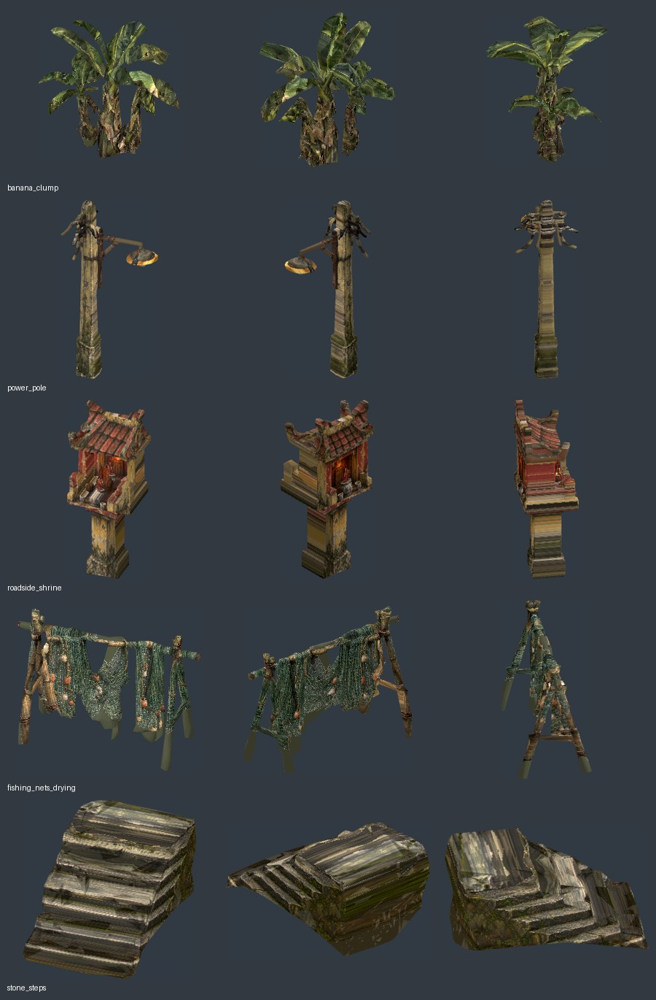
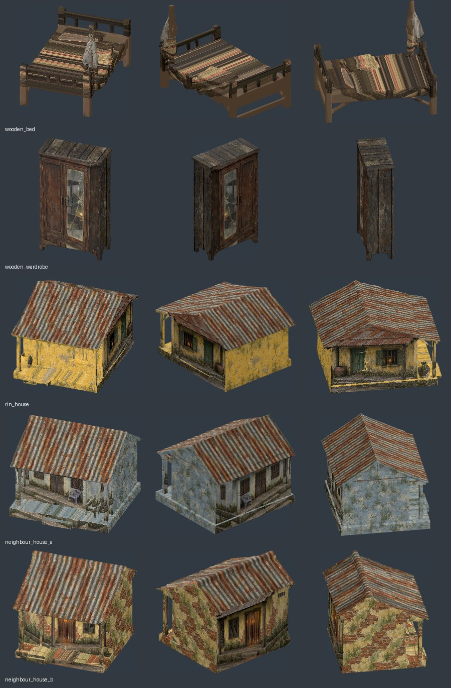

# Horror models — tích hợp 2026-11-03

Đã hoàn tất phần còn dở của đợt 25 model Hunyuan: đưa source và bản reduced vào
`assets/models/ready/`, tô màu runtime, thay placeholder, review nhiều góc / kích
thước chơi, kiểm thử và cập nhật tài liệu. Chưa commit/push.

## Kết quả trong game

Ảnh riêng: [phòng](art_reviews/horror_gameplay_room_20261103.jpg),
[hẻm sáng](art_reviews/horror_gameplay_lane_morning_20261103.jpg),
[bến](art_reviews/horror_gameplay_waterfront_20261103.jpg),
[hẻm đêm](art_reviews/horror_gameplay_lane_night_20261103.jpg),
[cá trên tay](art_reviews/horror_gameplay_fish_in_hand_20261103.jpg),
[cần và phao](art_reviews/horror_gameplay_rod_and_bobber_20261103.jpg).

- Bảy model hải sản thay hình cá tạm trong tay, giỏ và mâm ở quán. Cá dài chuẩn
  khoảng 0,32 m trước hệ số kích cỡ; tôm đôi/ốc ba con giữ nguyên concept.
- Giỏ và phao là model inference; cần giữ biến dạng khi căng dây, đầu dây bám đầu
  cần. Props không dùng rig nhân vật; ba NPC đã có PSX rig được giữ nguyên.
- Phòng có giường, tủ, bàn trà, bàn thờ, nón treo; lu đặt ngoài cửa.
- Hẻm thay model nhà, rào, chuối, cột điện, miếu. Bến có khung phơi lưới, bậc đá,
  nhà hàng xóm. Giữ collider và điểm tương tác riêng để luồng đi không đổi.
- Model `rin_house` kín dùng cho epilogue. Nhà Rin chơi được vẫn là cấu trúc có
  phòng/cửa thật, dùng vật liệu và nội thất mới, tránh mesh kín che cửa hoặc phòng.
- HUD quán chỉ hiện trong ca. Giảm ambient và ánh sáng chính lúc sáng sớm để hạn
  chế bạc màu dãy quán; các pha ca/đêm và môi trường trong phòng vẫn độc lập.

## Review 25 model, ba góc mỗi model

Các ảnh này là render Godot của GLB thực và material runtime; không phải ảnh gen.

Tổng reduced **68.998 tam giác**. Giữ raw và bản giảm trước sửa của bụi chuối/bậc
đá trong nguồn local; bản reduced dùng trong game lần lượt 3.000 / 2.998 tam giác.
Các bản còn lại đúng ngân sách 2.000, 3.000 hoặc 5.000.

## Material, source và giới hạn

Bản reduced dùng trong game đã được thêm normals hữu hạn và có độ dài đơn vị;
đã so sánh toàn bộ vertex/index với nguồn và xác nhận hình học không đổi.
`source_reduced_sha256` giữ checksum nguồn; `reduced_sha256` là checksum bản có
normals. Raw và bản tải online trong build không bị sửa.

`ConceptModel3D` dùng shader có nhận ánh sáng, nearest filtering, crop ảnh concept
và màu dự phòng lấy từ chính ảnh nguồn; chọn trục chiếu phù hợp với mesh dài/dẹt.
Mặt bên và mái nhà/tủ dùng texture lặp để tránh kéo một dải pixel ra cả bề mặt.
Đây là phép tô màu phù hợp pipeline hiện có, chưa phải UV/PBR bake đầy đủ: vài mặt
khuất và chi tiết nhỏ vẫn có màu phẳng hoặc chi tiết không khớp hoàn toàn. Không
gọi đây là art approved; cần người dùng đánh giá thẩm mỹ trong lần chơi thử.

`horror_models.json` ghi kích thước, principal axis, đầu cần, crop và màu dự phòng;
`horror_models.gd` chứa dữ liệu tương đương để Godot preload khi export. Source
PNG approved không bị thay. GLB gốc inference không bị dựng lại bằng primitive.

Mỗi thư mục `assets/models/ready/<id>/` chứa raw/reduced, provenance và license.
Bản online ban đầu còn trong `build/hunyuan_free/`. Các file có trước khi tích hợp
được backup tại `.art_backups/horror_integration_20261103/`; các bản trước thêm
normals có trong `.art_backups/horror_prepare/`. Mỗi đợt có manifest SHA-256.

## Kiểm thử

- `tools/run_tests.sh`: 32 scene test/smoke, 680 kiểm tra pass, 0 fail / 0 lỗi: **ALL OK**.
  Sau bổ sung collider lu và khung lưới, test model/đường đi riêng đạt 58 pass.
- `tools/run_bot.sh`: qua vòng reset, bảy ngày, từ chối trà, thấy anh Út ở bè,
  kết thật: **BOT OK**. Dùng `--no-autosave`, không ghi bản lưu của người chơi.
- Test mới `horror_models_test`: 25 model import, chiều cao / bám đất, normals hữu hạn để nhận sáng, cá mú căn
  ngang tay, cần đổi đầu mút theo lực căng, HUD chỉ hiện trong ca, đường hẻm thông.
- Render material và 6 khung cảnh gameplay bằng Compatibility; chưa có phép đo
  FPS trên Windows hoặc so sánh riêng renderer Forward+.

Tool review tái chạy: `tools/art/review_horror_models.gd` và
`tools/art/capture_horror_integration.tscn`; hướng dẫn trong `3D_DEMO.md`.

## Brief 4, mục 0 — bot sau reset

Đã đồng bộ với nhánh hiện hành chứa Vy và hệ phụ đề/uncanny mới, giữ cả các mục
PLAN. Bot trước đây coi fade kết thúc là đã điều khiển được, trong khi
`NightmareWake3D` vẫn có thể giữ `VillageScene3D.waking`. Nếu ca được bot chạy
nhanh, lần E xuống thúng bị `_interact` bỏ qua và bot chờ cảnh biển mãi.

`ready_to_drive` nay đợi hoạt cảnh trả quyền điều khiển trước khi bot chạy ngày
mới. Không bỏ khóa input của người chơi, không sửa luật câu cá hoặc tăng timeout
để che lỗi. `ghost_visit_test` kiểm gate lúc đang tỉnh / sau khi trả điều khiển.
Chạy test rồi bot tuần tự sau import: ALL OK / BOT OK; log xác nhận có đợi wake
và tiếp tục sau reset tới kết thật. Đường dẫn log local:
`build/horror_integration/brief4_tests0_final.log`, `brief4_bot0_final.log`.
